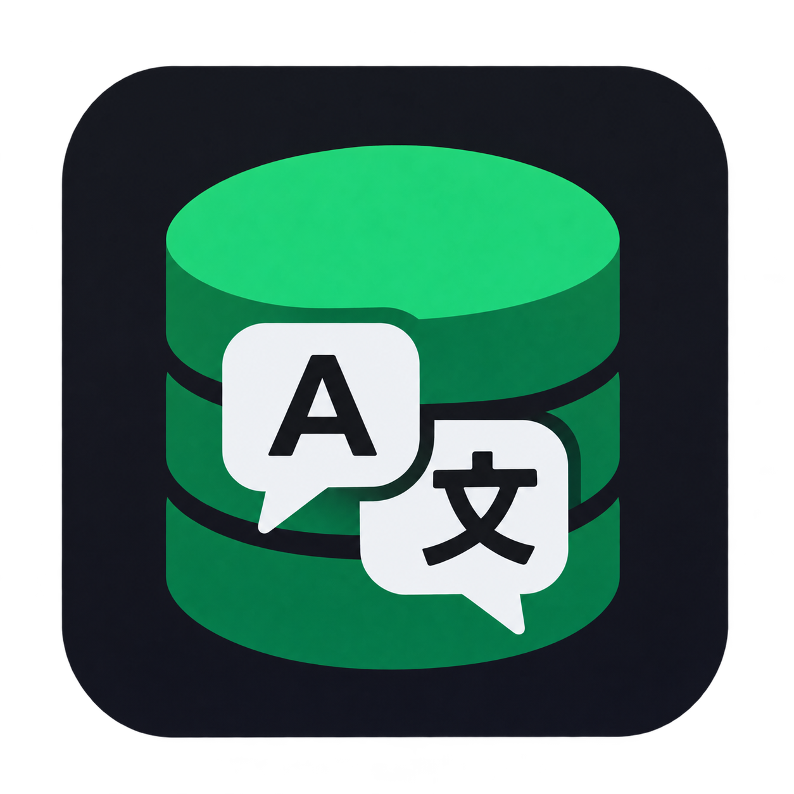

# LibreTranslate remote database

[](https://github.com/shadersmods/libretranslate-remote-database/actions/workflows/validate.yml)
[](https://github.com/shadersmods/libretranslate-remote-database/actions/workflows/check-instances.yml)
[](https://nodejs.org/)
[](data/instances.json)
[](LICENSE)

A source-backed catalog of public LibreTranslate candidates, checked daily. A website that loads is not necessarily an open translation API.

[Current status](STATUS.md) · [All results](data/status.json) · [Working anonymous APIs](data/open.json) · [Catalog](data/instances.json)

**Note:** Search results are candidates, not proof of availability or permission to use an operator's service.

## Database files

| File                           | Purpose                                                                       |
| ------------------------------ | ----------------------------------------------------------------------------- |
| `data/instances.json`          | Maintained URLs, names, source links, and opt-out switches                    |
| `data/status.json`             | Latest endpoint results, languages, formats, limits, versions, and timestamps |
| `data/open.json`               | Only instances that passed the latest anonymous translation check             |
| `data/history/YYYY-MM-DD.json` | Daily summaries, retained for 90 UTC calendar days                            |
| `STATUS.md`                    | Generated status table for people                                             |

The status table shows a flag before each website name, language and file-format counts with hover lists, and the anonymous character limit. A limit of `-1` is shown as Unlimited; a missing limit is shown as a dash.

Countries are approximate hosting locations, based on public server IPs and [Country.is](https://country.is/). They can identify a CDN or proxy location and do not establish the operator's country. Lookups are batched and cached by IP for 30 days. Failed lookups show a globe and do not affect the API result. The report loads flag images from [Flagpedia / Flagcdn](https://flagpedia.net/download/api).

All generated files use `schema_version: 1` and UTC ISO 8601 timestamps. Multiple runs on the same UTC date replace that day's summary. History preserves observations, not continuous uptime measurements. Failed checks leave the maintained catalog in place. The daily workflow proposes removal through a reviewed pull request after the offline threshold below is met.

For a GUI or another client, fetch the open list:

```text
https://raw.githubusercontent.com/shadersmods/libretranslate-remote-database/main/data/open.json
```

Read `generated_at` / `checked_at` before offering an instance; a result older than 48 hours should be treated as stale. Check the connection again before using it. Operator terms and capacity still apply, and translation text is sent to the selected operator.

## What gets checked

Each enabled server receives four sequential GET requests: `/health`, `/languages`, `/frontend/settings`, and its homepage. The checker then sends at most one small anonymous `POST /translate` containing `hello`. It prefers English → Spanish and otherwise chooses an advertised source/target pair. No files, real user text, or API keys are sent. A test is skipped when no usable language pair is advertised.

`api_access` describes the observed anonymous API response:

| Value                     | Meaning                                                           |
| ------------------------- | ----------------------------------------------------------------- |
| `open`                    | A 2xx response contained a nonempty `translatedText`              |
| `key_required`            | The server rejected the anonymous request with an API-key error   |
| `authentication_required` | HTTP 401 without an API-key-specific error                        |
| `rate_limited`            | HTTP 429; `Retry-After` is recorded when present                  |
| `blocked`                 | Access was forbidden or the response was not translation JSON     |
| `unverified`              | Skipped, unreachable, malformed, or another inconclusive response |

`availability` describes what this checker could verify:

| Value | Meaning |
| --- | --- |
| `online` | Valid languages and a recognizable translation response; an opted-out POST can also qualify with valid languages and health |
| `degraded` | An HTTP response arrived, but the API checks were incomplete |
| `unreachable` | DNS, TLS, routing, timeout, address filtering, or another inconclusive connection failure |
| `offline` | All four initial GETs and the delayed language GET returned `ECONNREFUSED` for validated public addresses |
| `disabled` | Checks were explicitly disabled for this entry |

The report includes a **Check detail** column. JSON endpoint results retain the Node error code and whether failure occurred during URL validation, DNS lookup, or the request. For example, an IPv6-only host with `ENETUNREACH` is unreachable from this checker and does not start an offline countdown. DNS lookup errors do not prove a domain is absent; [Node documents other causes of `ENOTFOUND`](https://nodejs.org/docs/latest-v24.x/api/dns.html#dnslookuphostname-options-callback).

These are observations from one network. A working site can remain unreachable from a GitHub runner because of IPv6 support, WAF rules, regional restrictions, or temporary routing failures. Even a refused connection is evidence for human review, not proof of worldwide downtime. Consumers of `data/status.json` should handle the `unreachable` value; `data/open.json` still includes only successful current anonymous translation probes.

Public settings' `keyRequired` is stored separately from the actual anonymous translation result. It does not override a successful or rejected API request. An HTML login or challenge page is never counted as a working translation API. Endpoint failures include DNS, TLS, timeout, oversized body, and HTTP status details. The homepage version is informational: different LibreTranslate versions remain eligible.

The default is three instances at once and ten seconds per request. Requests to one instance are sequential. If all four initial GETs return no HTTP response, the checker waits two seconds and rechecks `/languages` once with a fresh DNS lookup, another validated public IP when available, and a deadline of 1.5 times the normal timeout, capped at 30 seconds. Known routing, TLS, and address-filter failures skip that recheck. A recovered language list can enable the single translation probe. POST requests and HTTP error responses, including rate limits, are never retried. HTTPS checks keep TLS verification enabled. HTTP-only entries require an explicit `allow_insecure_http: true` opt-in; their traffic is unencrypted. Bodies are limited to 1 MiB. Redirects are recorded without following them; update the catalog's base URL if a server moves. DNS results must be public addresses and are pinned for the request. Local, private, reserved, and link-local destinations are rejected.

## Run locally

Requires Node.js 24 or later. No dependency installation, database server, API key, or GitHub secret is needed.

```sh
npm run validate
npm test
npm run check
npm run cleanup:plan
```

Optional controls:

```sh
node scripts/check.mjs --concurrency 2 --timeout 15
node scripts/check.mjs --no-translation
node scripts/check.mjs --catalog data/instances.json --out-dir /tmp/lt-data --report /tmp/lt-status.md
```

`--validate` and the tests make no external requests. Live checks exit successfully even if instances are down, so outages are saved as data. Invalid catalog data, checker bugs, or output failures fail the run and preserve the error in Actions. A whole-network outage can make every candidate appear unreachable; inspect the per-endpoint errors before drawing conclusions.

## Daily GitHub check

The `Check instances` workflow runs at **08:17 Europe/Bucharest**, including daylight-saving adjustments. It also has a **Run workflow** button. It tests the checker, probes the catalog, updates the generated files and Actions summary, then commits results back to the default branch using `GITHUB_TOKEN`. No personal access token is required.

To activate it:

1. Commit and push this repository to its GitHub default branch (`main`).
2. Enable Actions for the repository if disabled.
3. Allow the workflow's `contents: write` and `pull-requests: write` permissions under your repository/organization policy. Branch rules must allow the bot's generated-data commits; otherwise use a permitted results branch or change publication to pull requests.
4. Under **Settings → Actions → General → Workflow permissions**, enable **Allow GitHub Actions to create and approve pull requests**. Organization policy may control this setting; see [GitHub's instructions](https://docs.github.com/en/repositories/managing-your-repositorys-settings-and-features/enabling-features-for-your-repository/managing-github-actions-settings-for-a-repository#preventing-github-actions-from-creating-or-approving-pull-requests).
5. Run **Actions → Check instances → Run workflow** once to verify the first hosted check.

The local generated results do not mean the GitHub schedule has run. GitHub schedules run from the default branch and can be delayed; public repositories' inactive schedules can be disabled after 60 days. See [GitHub's schedule documentation](https://docs.github.com/en/actions/reference/workflows-and-actions/events-that-trigger-workflows#schedule).

Pull requests run offline tests and catalog validation with a read-only token. They do not probe proposed URLs or commit results. Action versions are pinned to immutable commits and Dependabot checks for updates weekly. Concurrent daily runs queue rather than overwriting each other.

## Removal pull requests

After publishing the daily results, the workflow prepares one pull request on `automation/remove-offline-instances`. It proposes removing entries from `data/instances.json` only when:

- The latest check is `offline` under the connection-refusal policy, and the recorded outage spans **more than seven full days**.
- Eight consecutive UTC dates contain the same URL and outage start time, with saved refusal evidence for all four GET endpoints and the delayed GET recheck on every date.
- The current results are fresh, and at least one other enabled instance returned an HTTP response.

`offline_since` records the first qualifying refusal check in the current streak. Timeouts, DNS, TLS and routing failures cannot start or extend that streak. Any HTTP response, including an API-key requirement, rate limit, or degraded service, also breaks it. A skipped UTC date, a gap over 36 hours, a changed URL, or a disabled instance resets or excludes it. Repeated checks on one day do not count as extra days. Older offline summaries without the new refusal evidence are ineligible and cannot carry their countdown forward. The evidence is stored in `down_check` in both current status and daily history.

The PR lists outage timestamps and links to daily evidence. Subsequent runs update the same PR, drop recovered sites, and close it if no candidates remain. A maintainer reviews and merges removals. Observations from this checker cannot prove continuous downtime or rule out a regional network problem.

Use `npm run cleanup:plan` to inspect `.cleanup/plan.json` and `.cleanup/pull-request.md` without changing the catalog. The workflow uses `npm run cleanup:prepare` to prepare catalog changes, then validates and tests them before opening the PR. These commands make no network requests or Git changes. The `.cleanup/` directory is ignored by Git.

The workflow uses the built-in `GITHUB_TOKEN` and a [pinned Create Pull Request action](https://github.com/peter-evans/create-pull-request). GitHub can require a maintainer to select **Approve workflows to run** on bot-created PRs; see [GitHub's workflow-trigger rules](https://docs.github.com/en/actions/how-tos/write-workflows/choose-when-workflows-run/trigger-a-workflow#triggering-a-workflow-from-a-workflow). If hosted validation is required, approve the pending runs or manually run **Validate database and checker** on the removal branch before merging.

## Add or remove an instance

Add an entry to `data/instances.json`, then run `npm run validate` and `npm test`:

```json
{
  "id": "example",
  "name": "Example translator",
  "url": "https://translate.example.org/prefix",
  "sources": ["https://example.org/translation-service"],
  "enabled": true,
  "probe_translation": true,
  "notes": "Optional operator information."
}
```

Use the actual API base URL, preserving deployment prefixes and explicit ports. Prefer HTTPS; an HTTP-only entry must also set `allow_insecure_http` to `true`. Do not append `/translate`, put keys in URLs, include private servers, or assume an operator permits general use because a search engine indexed the page. Keep source links for review. This repository does not crawl Google or automatically add unreviewed hosts.

Set `probe_translation` to `false` to disable POST checks for an operator; its GET information remains available and it cannot enter `open.json` without a successful current probe. Set `enabled` to `false` to make no requests at all. Operators can request removal through a GitHub issue or pull request. Do not submit API keys or other credentials.

See [CONTRIBUTING.md](CONTRIBUTING.md) for contribution steps and the [Code of Conduct](CODE_OF_CONDUCT.md) for participation rules. Report vulnerabilities through [SECURITY.md](SECURITY.md). This repository uses the [MIT license](LICENSE).
